# From Reviews to Revenue: Customer Sentiment & Business Risk Analysis for E-Commerce

**What are customers actually complaining about, and how much order value is tied to those complaints?**

An end-to-end analytics project on the Olist Brazilian E-Commerce dataset. It combines unstructured review text (multilingual NLP on Portuguese reviews) with structured order, delivery, product and seller data, then serves the results through a SQL layer and a Next.js dashboard.

> **Currency:** all money is in Brazilian Reais (**R$, BRL**).
> **Causality:** all statistics are **associations**, not causal effects (observational data).
> **Exposure:** all exposure figures are **scenario-based estimates, not observed revenue loss**.

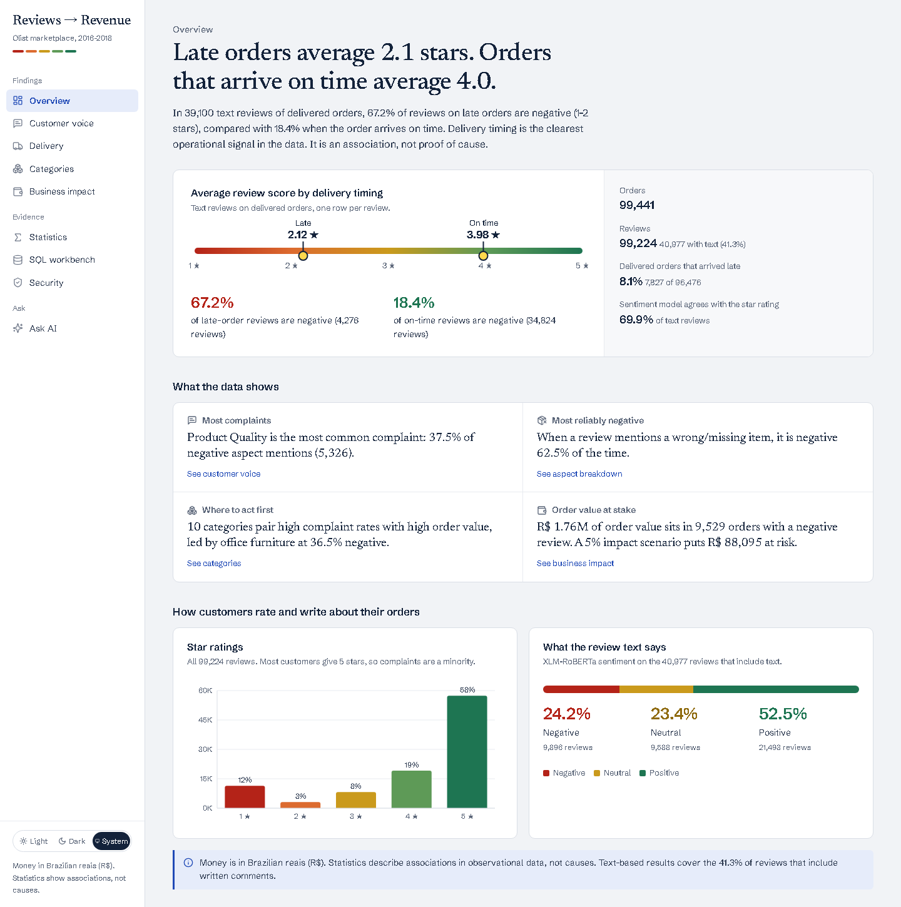

---

## Executive Summary

The pipeline builds a star schema from 9 relational CSVs (99,441 orders, 112,650 order items, 99,224 reviews), runs XLM-RoBERTa sentiment, embedding-based topic modeling and data-driven aspect extraction on the **40,977 reviews that contain text (41.3%)**, and joins the results back to orders, categories, sellers and delivery data.

Key findings (all from saved outputs in `data/processed/`):

- **Late delivery is the strongest operational signal.** Late orders average **2.12** stars vs **3.98** on time, and **67.2%** of late-order text reviews are negative (score ≤ 2) vs **18.4%** on time. Spearman ρ (delay vs score) = **−0.217**, N = 39,100 reviews.
- **What customers complain about:** when a review mentions a *Wrong/Missing Item*, **62.5%** of those reviews are negative; *Packaging* **55.5%**; *Customer Service* **38.4%**. The three most negative topics (order not received, partial/missing orders, item not matching the listing) account for **86.8%** of negative-sentiment reviews.
- **Where to act first:** 10 categories (≥ 100 reviews) are above the median on both negative-sentiment rate and order value — led by `office_furniture` (36.5% negative), `computers_accessories`, `telephony`, `furniture_decor` and `watches_gifts`.
- **Scenario exposure:** **R$ 1,761,899.57** of order value (9,529 orders) is tied to negative-sentiment reviews. Under a 5% impact assumption that is **R$ 88,095** — a scenario, not a measured loss.

---

## 1. Business Problem

Most e-commerce decisions rely on the average star rating, which hides *why* customers are unhappy. This project answers three questions:

1. **What are customers complaining about?** (sentiment, topics, aspects)
2. **Which categories and sellers combine high complaint risk with high order value?** (prioritization)
3. **How strongly do delivery delay, price and freight associate with negative reviews?** (statistics, association only)

---

## 2. Dataset & Real Constraints

**Source:** [Olist Brazilian E-Commerce Public Dataset](https://www.kaggle.com/datasets/olistbr/brazilian-ecommerce), downloaded with `kagglehub`:

```python
import kagglehub
path = kagglehub.dataset_download("olistbr/brazilian-ecommerce")
```

`src/data/download_data.py` runs this and copies the 9 CSVs into `data/raw/` (gitignored).

| Table | Rows |
|---|---|
| orders | 99,441 |
| order_items | 112,650 |
| order_reviews | 99,224 |
| order_payments | 103,886 (aggregated to 99,440 orders) |
| products | 32,951 |
| customers | 99,441 |
| sellers | 3,095 |
| geolocation | 1,000,163 (deduplicated to 19,015 zip prefixes) |
| category_name_translation | 71 |

**Constraints discovered and respected:**

- **BRL only.** No cost, profit, marketing or CLV data — none is estimated.
- **No returns/refund table and no size/fit attribute.** Return rates and "sizing complaints" cannot be computed and are not claimed.
- **Text coverage is 41.3%** (40,977 of 99,224 reviews have `review_comment_message`). All NLP results apply only to this subset, which likely skews toward strong opinions.
- **Portuguese text.** Multilingual models are used directly; no English-only tools (e.g. raw VADER).
- **Anonymisation.** Company names inside review text are replaced with Game of Thrones house names (e.g. "lannister" appears in Topic 0's terms). Seller and customer IDs are hashes.
- **Positive skew.** 57,328 reviews (57.8%) are 5-star, so complaints are a minority class.
- **`review_id` is not unique.** 40,977 text reviews have only 40,668 distinct `review_id`s; `(review_id, order_id)` is the real key.
- **Encoding noise.** 424 raw review texts contain mojibake (e.g. `ã`); they are kept as-is.

---

## 3. Data Architecture — Star Schema

Built in Stage 1 (`src/data/make_dataset.py`), saved as Parquet in `data/processed/`.

```
                       ┌──────────────────┐
                       │   fact_orders    │  1 row per order (99,441)
                       └────────┬─────────┘
                                │ order_id
       ┌────────────────────────┼─────────────────────────┐
┌──────▼──────────┐   ┌─────────▼─────────┐     ┌─────────▼────────┐
│fact_order_items │   │fact_order_reviews │     │  dim_payments    │
│ 112,650 rows    │   │ 99,224 rows       │     │ 99,440 (order    │
│ price, freight  │   │ + nlp_reviews     │     │  grain)          │
└──┬──────────┬───┘   │   (40,977 rows)   │     └──────────────────┘
   │          │       └─────────┬─────────┘
   │product_id│seller_id        │ emb_topic_id
┌──▼────────┐ ┌▼───────────┐  ┌─▼──────────┐   ┌──────────────┐  ┌───────────────┐
│dim_products│ │dim_sellers │  │ dim_topics │   │dim_customers │  │dim_geolocation│
│ 32,951     │ │ 3,095      │  │ 8 topics   │   │ 99,441       │  │ 19,015 zips   │
└────────────┘ └────────────┘  └────────────┘   └──────────────┘  └───────────────┘
```

**Risky joins handled explicitly:** an order can have several items (so joining reviews to items repeats a review), several payments (aggregated to order grain), and occasionally several reviews. Every Stage 4 metric is computed over **unique reviews** — see §5.

No fact rows are dropped in Stage 1. Geolocation is deduplicated to one row per zip prefix and payments are aggregated to one row per order; both are logged by the script.

---

## 4. Data Dictionary

| Column | Table | Description |
|---|---|---|
| `order_id` | fact_orders | Primary key |
| `order_delivered_customer_date` | fact_orders | Actual delivery date (null if not delivered) |
| `order_estimated_delivery_date` | fact_orders | Estimated delivery date shown to the customer |
| `price`, `freight_value` | fact_order_items | Item price and freight in R$ |
| `review_score` | fact_order_reviews | Rating 1–5 |
| `review_comment_message` | fact_order_reviews | Free text (41.3% non-null) |

**NLP features (`nlp_reviews.parquet`, Stage 3)**

| Column | Description |
|---|---|
| `sentiment_label`, `sentiment_score` | XLM-RoBERTa label (Positive / Neutral / Negative) and confidence |
| `baseline_sentiment_label` | Portuguese lexicon baseline label |
| `tfidf_topic_id` | TF-IDF + NMF topic (baseline) |
| `emb_topic_id` | Sentence-embedding + KMeans topic (joins to `dim_topics`) |
| `extracted_aspects` | List of aspects mentioned (not mutually exclusive) |
| `sentiment_agrees` | NLP label matches the label implied by the star rating |

**Derived metrics (`src/utils/metrics.py`, Stage 4)** — one definition shared by the pipeline and the tests

| Metric | Definition |
|---|---|
| `delay_days` | delivered − estimated, in days (NaN if not delivered) |
| `is_late` | 1 if `delay_days > 0`, 0 if on time/early, **NaN if not delivered** |
| `is_neg_review` | `review_score <= 2` |
| `is_neg_sentiment` | `sentiment_label == 'Negative'` |
| `order_value` | sum of `price + freight_value` over the order's items |

---

## 5. Methodology

### Stage 1 — Acquisition, audit, star schema
`download_data.py` → `make_dataset.py`. Schema audit (row counts, missingness, key uniqueness, foreign keys), category-translation patches for the 2 untranslated categories, Parquet star schema.

### Stage 2 — EDA & feature engineering
`run_eda.py` (14 charts in `reports/figures/`) and `build_features.py` (`features_orders.parquet`: delay, order value, freight ratio, items per order, outlier flags).

### Stage 3 — NLP (`src/nlp/nlp_pipeline.py`)
**Language decision:** use multilingual models directly on Portuguese rather than machine-translate 40,977 reviews (translation adds noise, cost and rate limits).

| Method | 500-review benchmark (CPU) |
|---|---|
| Portuguese lexicon baseline | < 1 s |
| XLM-RoBERTa sentiment (`cardiffnlp/twitter-xlm-roberta-base-sentiment`) | 179.3 s |
| Sentence embeddings (`paraphrase-multilingual-MiniLM-L12-v2`) | 50.0 s |
| TF-IDF + NMF | 0.9 s |

The full transformer run is batched (32) with a checkpoint every 2,000 reviews in `data/processed/checkpoints/` (gitignored, regenerated on demand).

- **Topics:** TF-IDF + NMF baseline and embeddings + MiniBatch KMeans (8 topics). Clusters are described with c-TF-IDF terms and sample reviews; business names are assigned in `src/nlp/topic_names.py` and stored in `dim_topics.csv`.
- **Aspects:** terms that are disproportionately frequent in negative reviews were mined from the data and grouped into 7 aspects plus *Uncategorized*.

### Stage 4 — Business analytics, statistics, SQL (`src/analytics/stage4_analysis.py`)
- **Grain:** the joined table is review × order item (47,642 rows for 40,453 reviews that have order items). Statistics use **one row per review** with order-level price/freight; category/seller/product metrics use **one row per (group, review)**. Rates are therefore never inflated by multi-item orders.
- **Sample-size thresholds:** products/sellers ≥ 30 reviews, categories ≥ 100. Real example: product `0009406f…` has 1 review and a 100% negative rate, while `06edb72f…` has 62 reviews and 24.2% — without a threshold the 1-review product would rank as "worse".
- **Tests:** Spearman (ordinal scores, non-normal predictors), Mann-Whitney U (two groups), Kruskal-Wallis H (price bands, categories), logistic regression for P(negative review).
- **Exposure model:** `exposure = affected_order_value × impact_assumption`, with a sensitivity table.
- **SQL:** 11 DuckDB queries in `sql/`, validated by `validate_sql.py` and cross-checked against the Python output in the tests.

---

## 6. Key EDA Findings

**Review scores (all 99,224 reviews)**

| Score | Count | % |
|---|---|---|
| 5 | 57,328 | 57.8% |
| 4 | 19,142 | 19.3% |
| 3 | 8,179 | 8.2% |
| 2 | 3,151 | 3.2% |
| 1 | 11,424 | 11.5% |

**Delivery (96,476 orders with a delivery date)**

| Metric | Value |
|---|---|
| Late deliveries | 7,827 (8.1%) |
| Median delivery vs estimate | 11.9 days early |
| 95th percentile | 3.8 days late |
| Max delay | 189 days |

**Order economics**

| Metric | Value |
|---|---|
| Item revenue | R$ 13,591,643.70 |
| Freight | R$ 2,251,909.54 |
| Median / mean item price | R$ 74.99 / R$ 120.65 |
| Median freight per item | R$ 16.26 |

**Top 5 categories by item revenue:** health_beauty (R$ 1,258,681), watches_gifts (R$ 1,205,006), bed_bath_table (R$ 1,036,989), sports_leisure (R$ 988,049), computers_accessories (R$ 911,954).

---

## 7. NLP Results

### Sentiment (XLM-RoBERTa, 40,977 text reviews)

| Label | Count | % |
|---|---|---|
| Positive | 21,493 | 52.5% |
| Negative | 9,896 | 24.2% |
| Neutral | 9,588 | 23.4% |

| Agreement with star rating | Rate |
|---|---|
| Transformer | **69.88%** |
| Lexicon baseline | 65.76% |

Per score (transformer): 5★ 82.6% · 4★ 58.8% · 3★ 37.8% · 2★ 56.4% · 1★ 63.9%. Three-star reviews are the most ambiguous. Disagreements include 5-star reviews that complain in text ("o produto é fraco") and 1-star reviews whose text is about something else.

### Topics (embeddings + KMeans)

| Topic | Business name | Reviews | Negative sentiment | Representative terms |
|---|---|---|---|---|
| T0 | Positive Shopping Experience | 5,864 | 1.6% | produto, recomendo, prazo, entrega, loja |
| T1 | Order Receipt / Delivery Problems | 5,193 | 54.5% | recebi, comprei, veio, correios, nao |
| T2 | Product Quality Praise | 4,056 | 1.0% | produto, qualidade, bom, ótimo, excelente |
| T3 | Early Delivery Satisfaction | 6,462 | 3.3% | prazo, antes, antes prazo, chegou antes |
| T4 | General Approval / Short Praise | 4,005 | 0.8% | bom, recomendo, tudo ok, perfeito |
| T5 | Mixed Delivery + Product Feedback | 5,365 | 17.4% | entrega, produto, bom, rápida |
| T6 | Product Expectation vs Reality | 4,759 | 58.8% | veio, diferente, foto, cor, porém |
| T7 | Delivery Status / Pending Orders | 5,273 | 56.0% | recebi, ainda, recebi produto, entregue |

Negative reviews by topic (`sql/09_complaint_breakdown.sql`): T7 29.9%, T1 28.6%, T6 28.3%, T5 9.4%, others 3.8%.

### Aspects (not mutually exclusive)

| Aspect | Mentions | Negative | % Negative |
|---|---|---|---|
| Wrong/Missing Item | 1,817 | 1,136 | **62.5%** |
| Packaging | 874 | 485 | **55.5%** |
| Price/Value | 1,790 | 695 | 38.8% |
| Customer Service | 4,918 | 1,889 | 38.4% |
| Description Mismatch | 1,853 | 633 | 34.2% |
| Product Quality | 18,450 | 5,326 | 28.9% |
| Delivery/Logistics | 18,181 | 4,028 | 22.2% |
| Uncategorized | 11,497 | 1,695 | 14.7% |

Every aspect has well over 100 mentions, so none is flagged low-N.

---

## 8. Statistical Findings

> Associations only. Observational data cannot establish causation.

Unit of analysis: **one row per text review on a delivered order (N = 39,100)**; price and freight are order totals.

### Spearman correlations

| Pair | ρ | p | N |
|---|---|---|---|
| Delivery delay vs review score | **−0.217** | < 1e-300 | 39,100 reviews |
| Freight vs review score | −0.119 | 7.3e-124 | 39,100 reviews |
| Order price vs review score | −0.055 | 1.2e-27 | 39,100 reviews |
| Negative-sentiment rate vs avg rating | −0.839 | 9.1e-11 | 37 categories |
| Negative-review rate vs avg rating | −0.981 | 1.3e-26 | 37 categories |

The last row is close to definitional (both come from the same star ratings). The negative-*sentiment* row is the meaningful one: text-based complaint rates track ratings closely at category level.

### Group comparisons

| Comparison | Result |
|---|---|
| On time vs late (Mann-Whitney U, one-sided) | 3.98 (N = 34,824) vs **2.12** (N = 4,276), p < 1e-300 |
| Low vs high freight (split at R$ 17.73) | 3.92 vs 3.63, p = 5.2e-69 |
| Order price bands (Kruskal-Wallis) | < R$50: 3.88 · 50–150: 3.79 · 150–500: 3.62 · > 500: 3.59; H = 120.4, p = 6.4e-26 |
| 37 categories (Kruskal-Wallis) | H = 397.5, p = 1.7e-62 |

### Logistic regression — P(negative review) ~ delay + price + freight

| Predictor | Coefficient | Odds ratio | p |
|---|---|---|---|
| delay_days | +0.0629 | 1.065 per day | < 0.001 |
| freight_value | +0.0119 | 1.012 per R$ | < 0.001 |
| price | +0.00003 | 1.000 | 0.67 (not significant) |

Pseudo R² = 0.079: delivery, price and freight explain only a small part of why reviews are negative. Once delay and freight are in the model, order price shows no detectable association.

---

## 9. Business Impact

### Scenario-based exposure

> ⚠️ **Scenario-based estimate, NOT observed historical revenue loss.** `exposure = affected_order_value × impact_assumption`.

Order value (items + freight) of orders with a negative-sentiment review: **R$ 1,761,899.57** across **9,529 orders**.

| Impact assumption | Scenario exposure |
|---|---|
| 1% | R$ 17,619.00 |
| 2% | R$ 35,237.99 |
| 5% | R$ 88,094.98 |
| 10% | R$ 176,189.96 |
| 15% | R$ 264,284.94 |
| 20% | R$ 352,379.91 |

### Prioritization (37 categories with ≥ 100 reviews)

Axes: negative-sentiment rate and item value in text-reviewed orders, split at the medians (23.5% and R$ 93,451).

| Segment | Categories |
|---|---|
| **HIGH risk + HIGH exposure — act first** (10) | office_furniture 36.5% (R$ 169,287, N=608) · unknown 29.9% · computers_accessories 27.6% (R$ 467,560) · telephony 27.3% · furniture_decor 26.3% · baby 26.2% · toys 24.4% · watches_gifts 24.0% (R$ 600,019) · housewares 23.9% · bed_bath_table 23.5% (R$ 598,658) |
| **HIGH risk + LOW exposure — fix cheaply** (8) | air_conditioning 32.0% · audio 30.8% · market_place 28.2% · consoles_games 27.8% · home_construction 26.0% · furniture_living_room 25.3% · home_appliances 24.4% · home_confort 24.2% |
| **LOW risk + HIGH exposure — protect** (8) | perfumery · pet_shop · health_beauty (R$ 555,099) · cool_stuff · stationery · sports_leisure · garden_tools · auto |
| **LOW risk + LOW exposure — monitor** (11) | electronics · musical_instruments · construction_tools_construction · home_appliances_2 · drinks · food · small_appliances · fashion_bags_accessories · luggage_accessories · fashion_shoes · books_general_interest |

Full table: `data/processed/stage4/business_prioritization.csv`.

---

## 10. Web Dashboard (Next.js)

A 9-page dashboard in `dashboard/` (Next.js 15, React 19, TypeScript, Recharts) with light, dark and system themes. It only **reads** precomputed outputs: `export_dashboard_data.py` writes small JSON files to `dashboard/public/data/` after reconciling them against the Parquet sources, and Next.js API routes serve them. No metric is recomputed in JavaScript. The SQL page runs the `sql/` queries (or your own SELECT) through DuckDB, sandboxed to `data/processed/` and read-only.

| Page | What it shows |
|---|---|
| Overview | Star ruler (late vs on-time ratings), headline findings, rating and sentiment distributions |
| Customer voice | Complaint aspects by volume and by negative rate, sentiment mix, named topics, model agreement |
| Delivery | Late rates by state and category, which complaints come from late orders, monthly trend |
| Categories | Rankings (N ≥ 100 only), price vs complaints, category × aspect heatmap, sortable table with low-N flags |
| Business impact | Scenario exposure, 2×2 prioritization, category table by group |
| Statistics | Spearman correlations, group tests, logistic regression with odds ratios |
| SQL workbench | Run the 11 project queries or your own SELECT |
| Security | Controls, penetration-test results, data integrity, security events, fraud signals |
| Ask AI | Chat assistant that answers questions from the project's data |

The sidebar switch chooses **Light**, **Dark** or **System** (follows the device). Every chart reads its colors from the theme, and sentiment always uses the same 1★ (red) to 5★ (green) scale.

| Light | Dark |
|---|---|
|  | 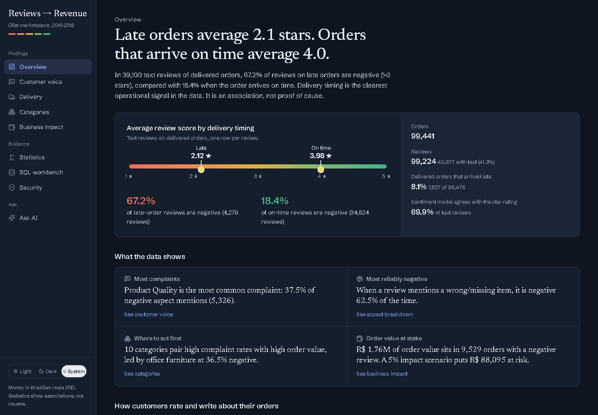 |

### Ask AI — chat assistant

The **Ask AI** page is a streaming chat assistant. It does not answer from memory: it calls two tools on the server and shows each lookup under its answer.

- `get_project_results` — reads the validated results that the dashboard pages use.
- `run_sql` — runs a read-only DuckDB query on the processed tables, through the same sandbox as the SQL page.

**Providers:** Groq is the primary provider (`openai/gpt-oss-120b`) and Gemini is the fallback (`gemini-3.8-flash`). Both are called through their OpenAI-compatible APIs. If Groq fails or is rate-limited before it starts answering, Gemini answers the question from scratch. The project's rules (R$, association rather than causation, scenario labels, low-N warnings) are part of the system prompt in `dashboard/lib/ai/prompt.ts`.

**Setup:** copy `dashboard/.env.example` to `dashboard/.env.local`, add `GROQ_API_KEY` and `GEMINI_API_KEY`, then restart the server. Either key on its own also works. `.env.local` is gitignored; the keys stay on the server and are never sent to the browser.

| | |
|---|---|
| **Customer voice**<br>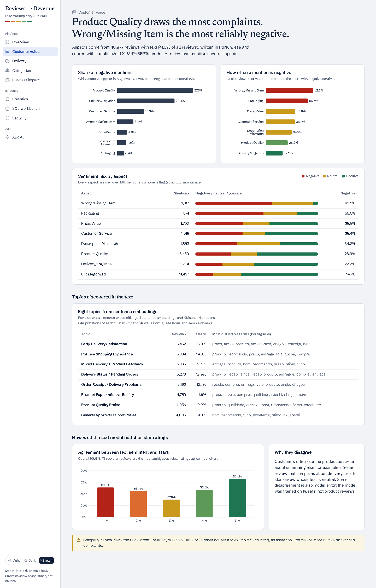 | **Business impact**<br>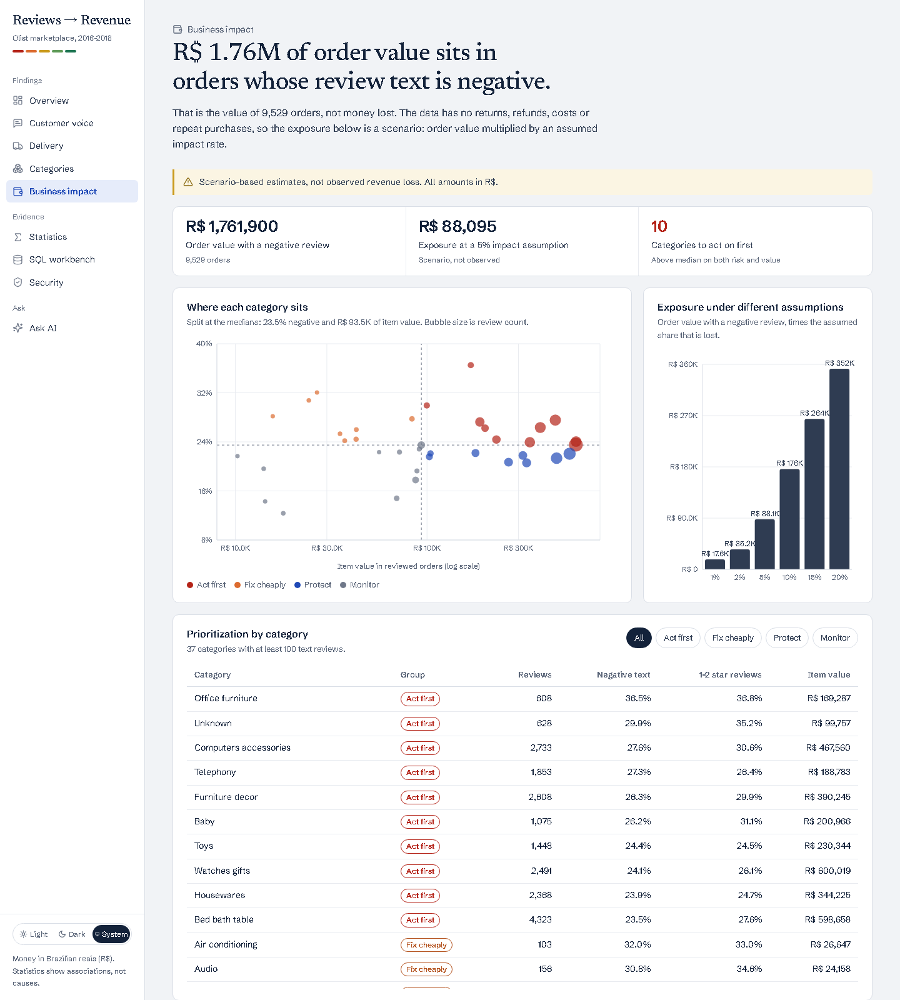 |
| **Delivery**<br>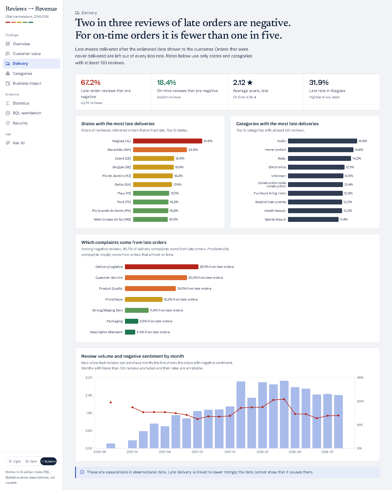 | **Categories**<br>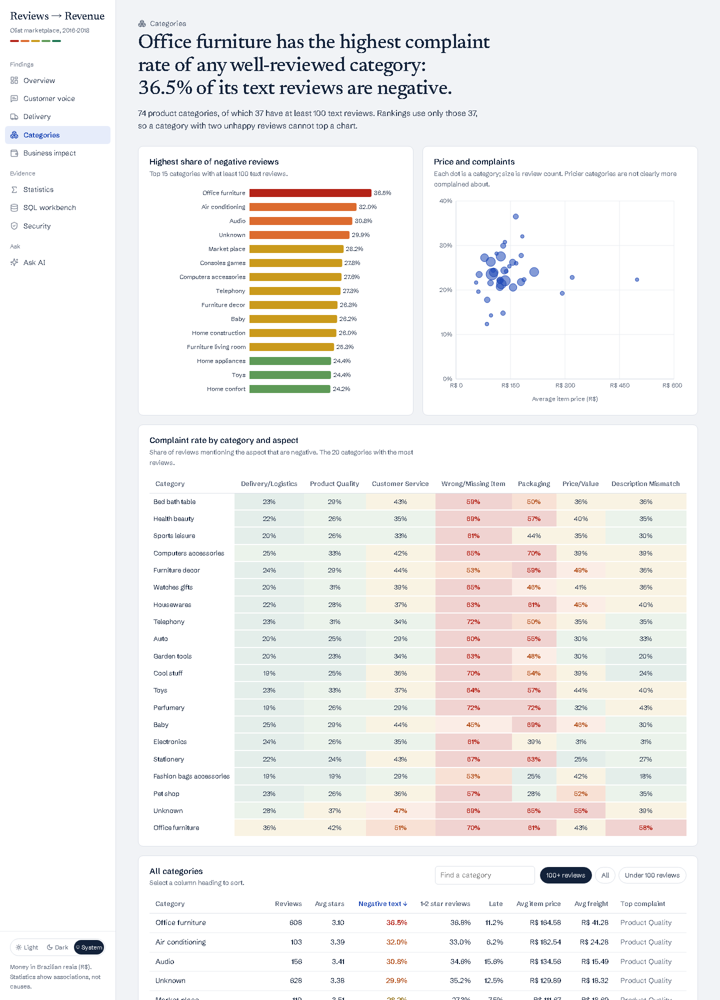 |
| **Statistics**<br>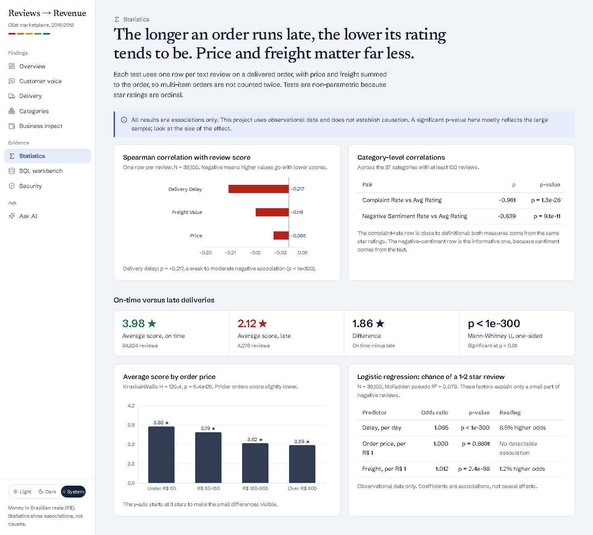 | **SQL workbench**<br>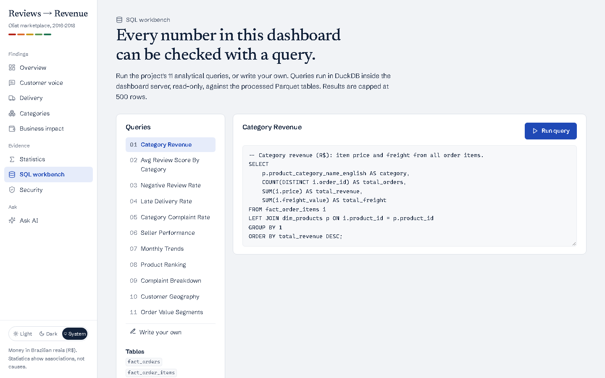 |
| **Security**<br>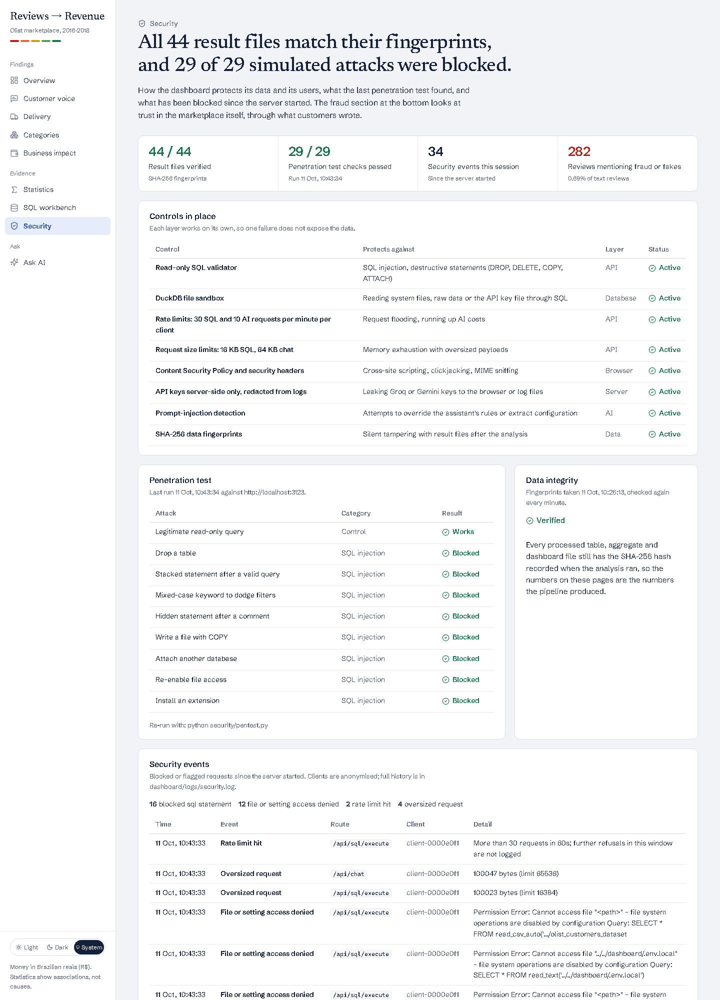 | **Ask AI**<br>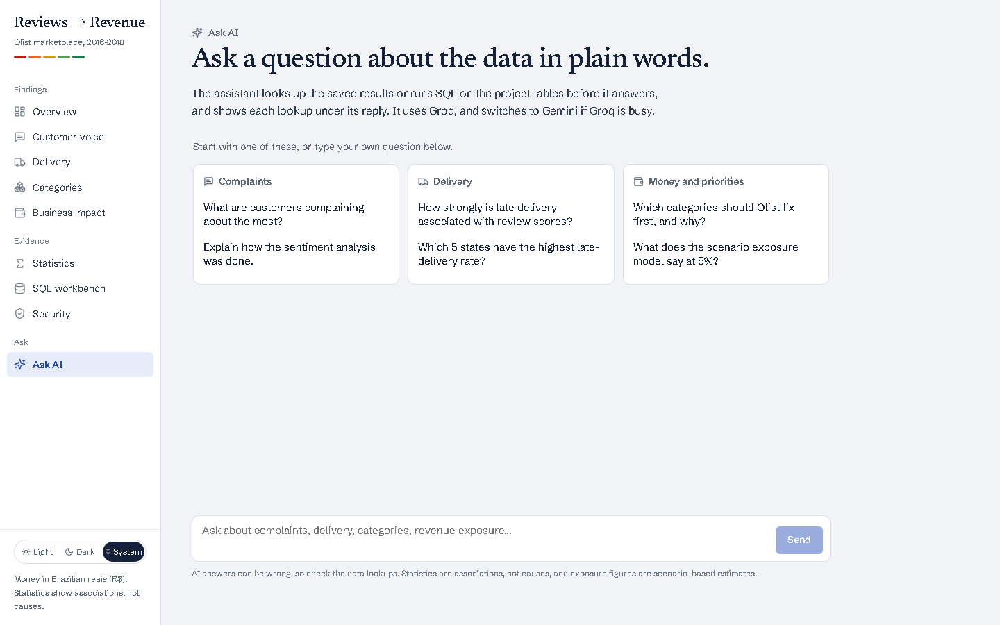 |

**Power BI:** not built yet. The star-schema Parquet files and `stage4/*.csv` are ready to import into Power BI Desktop if a BI version is needed.

### Security

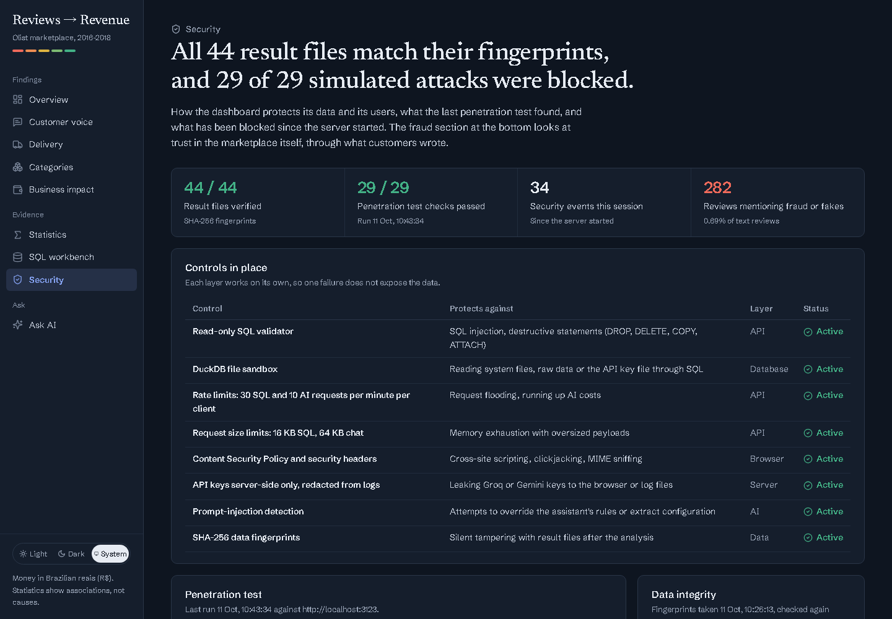

The dashboard treats every request as untrusted. Its **Security** page shows the controls, the last penetration test, blocked requests and fraud signals in the reviews.

| Area | What it does |
|---|---|
| SQL injection | A read-only validator allows one `SELECT`/`WITH` statement; the DuckDB sandbox cannot read files outside `data/processed/` or change its own settings |
| Abuse | Per-client rate limits (30 SQL and 10 AI requests per minute) and request-size limits (16 KB SQL, 64 KB chat) |
| Browser | Content Security Policy, `X-Frame-Options: DENY`, `nosniff`, `Referrer-Policy`, `Permissions-Policy`; no `X-Powered-By` |
| Secrets | API keys stay on the server, are never sent to the browser or the model, and are redacted from logs; errors hide server file paths |
| AI | Prompt-injection detection: suspicious messages are logged and the model is reminded of its rules |
| Integrity | SHA-256 fingerprints of the 44 result files (`data/processed/integrity_manifest.json`), re-checked by the dashboard every minute |
| Detection | Blocked and flagged requests go to an event log (`dashboard/logs/security.log`) with anonymised client IDs |

**Penetration test:** `python security/pentest.py` attacks a running dashboard (SQL injection, file theft, path traversal, oversized and malformed requests, request flooding, header checks) and writes `reports/security_report.md`. Latest run: **29 of 29 checks passed**.

**Fraud and counterfeit signals:** `src/analytics/fraud_signals.py` flags review text that mentions scams, fraud, counterfeit or stolen goods, using Portuguese keyword patterns. **282 text reviews (0.69%)** are flagged; they average **1.55 stars**, against 3.67 for all text reviews. One seller has flags in **36.8%** of its 76 text reviews. These are customers' claims, not confirmed fraud.

---

## 11. Limitations

1. **No returns, refunds, cost, profit or CLV data.** Exposure uses gross order value and an assumed impact rate.
2. **Text covers 41.3% of reviews.** The 58.7% without text are unobserved and probably less extreme.
3. **Positive skew** (57.8% five-star) makes complaints a minority class.
4. **Observational statistics only.** No experiment or instrument supports causal claims.
5. **Portuguese NLP caveats.** XLM-RoBERTa is trained on tweets; 30.1% of labels disagree with the star rating, reflecting both real ambiguity and model error.
6. **Aspects overlap and are rule-based.** A review can count toward several aspects.
7. **Topic names are interpretations** of KMeans clusters, and cluster ids can change if the pipeline is re-run.
8. **524 text reviews belong to orders with no items** (cancelled/unavailable), so Stage 4 covers 40,453 of 40,977 text reviews.
9. **Category value is attributed per item.** An order with items from two categories counts toward both.

## 12. Future Improvements

1. Add returns/refund, cost and repeat-purchase data for margin and CLV analysis.
2. Fine-tune a Portuguese sentiment model on human-labelled Olist reviews to lift the 69.9% agreement.
3. Replace KMeans with BERTopic or HDBSCAN for more stable topics.
4. Use quasi-experimental methods (e.g. difference-in-differences on carrier delays) to move beyond associations.
5. Deploy the dashboard (e.g. Vercel) with the SQL page served from a pre-built DuckDB file.
6. Build the Power BI version for BI-focused audiences.

---

## 13. Tech Stack

| Layer | Tools |
|---|---|
| Languages | Python 3.12+, SQL, TypeScript |
| Data | pandas, NumPy, PyArrow (Parquet), kagglehub |
| NLP / ML | Hugging Face Transformers (XLM-RoBERTa), Sentence Transformers, scikit-learn (TF-IDF, NMF, MiniBatch KMeans), NLTK, PyTorch |
| Statistics | SciPy, statsmodels |
| SQL engine | DuckDB |
| Dashboard | Next.js 15, React 19, Recharts |
| AI assistant | Groq (gpt-oss-120b) with Gemini fallback, OpenAI-compatible tool calling over DuckDB |
| Security | CSP and security headers, rate limiting, DuckDB sandbox, SHA-256 integrity manifest, automated penetration test |
| Testing | pytest |

---

## 14. Project Structure

```
├── config/settings.py              # paths, raw file names, constants
├── data/
│   ├── raw/                        # 9 Olist CSVs (gitignored; see download_data.py)
│   └── processed/                  # star schema + NLP + Stage 4 outputs
│       ├── fact_*.parquet, dim_*.parquet, features_orders.parquet
│       ├── nlp_reviews.parquet, nlp_topics.json, nlp_aspects.json, nlp_summary_metrics.json
│       ├── dim_topics.csv          # business names for the 8 topics
│       └── stage4/                 # agg_*.csv, complaint_matrix*.csv, business_prioritization.csv, stage4_metrics.json
├── src/
│   ├── data/                       # download_data, load_raw, make_dataset, run_eda, build_features
│   ├── nlp/                        # nlp_pipeline (Stage 3), topic_names
│   ├── analytics/                  # stage4_analysis, validate_sql
│   └── utils/metrics.py            # shared metric definitions
├── sql/                            # 11 analytical DuckDB queries
├── notebooks/01_results_walkthrough.ipynb
├── tests/                          # pytest: metric unit tests + data reconciliation
├── dashboard/                      # Next.js dashboard
├── reports/
│   ├── data_dictionary.md
│   └── figures/                    # 14 EDA charts + dashboard/ screenshots
├── export_dashboard_data.py        # Stage 6: reconciled JSON export for the dashboard
├── run.bat                         # one-click launcher (Windows)
└── requirements.txt
```

---

## 15. Setup & Reproduction

### Requirements
- Python 3.12+ and Node.js 18+
- Kaggle credentials (`~/.kaggle/kaggle.json`, or `KAGGLE_USERNAME` / `KAGGLE_KEY`) — only needed to rebuild from raw data

```bash
pip install -r requirements.txt
```

### One click (Windows)
`run.bat` skips any stage whose outputs already exist, exports the dashboard data and starts the dashboard at http://localhost:3000.

### Step by step

```bash
python src/data/download_data.py          # Stage 1: fetch the 9 CSVs with kagglehub
python src/data/make_dataset.py           # Stage 1: star schema
python src/data/run_eda.py                # Stage 2: EDA charts
python src/data/build_features.py         # Stage 2: features
python src/nlp/nlp_pipeline.py            # Stage 3: NLP (about 1.5 h on CPU, faster on GPU)
python src/nlp/topic_names.py             # Stage 3: topic lookup (re-check names after a re-run)
python src/analytics/stage4_analysis.py   # Stage 4: business analytics + statistics
python src/analytics/validate_sql.py      # Stage 4: run all SQL queries
python export_dashboard_data.py           # Stage 6: reconciled dashboard JSON
python -m pytest                          # tests
cd dashboard && npm install && npm run dev
```

The processed outputs are committed, so the dashboard, SQL, tests and notebook all work without re-running Stages 1–3.
